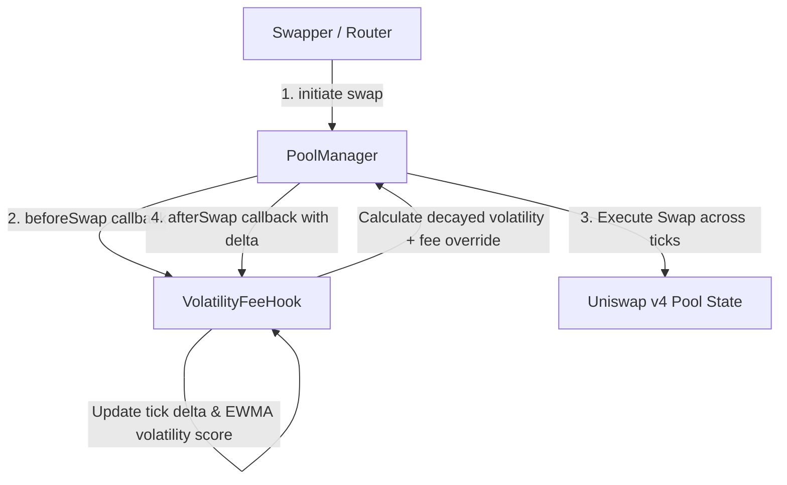

# ⚡ Uniswap v4 Dynamic Volatility-Fee Hook (Anti-LVR Protection)

[](https://getfoundry.sh/)
[](https://opensource.org/licenses/MIT)
[](https://soliditylang.org/)
[](https://v4-volatility-fee-hook.vercel.app)

A production-grade, gas-optimized **Uniswap v4 Hook** that dynamically scales liquidity provider (LP) swap fees in response to realized tick volatility, directly mitigating **Loss-Versus-Rebalancing (LVR)** and toxic MEV arbitrage.

🌐 **Live Telemetry & Interactive Visualizer**: [https://v4-volatility-fee-hook.vercel.app](https://v4-volatility-fee-hook.vercel.app)

---

## 🎯 The Problem: LVR & Toxic Arbitrage

In constant product and concentrated liquidity AMMs:
1. When external reference prices (Binance, Bybit, CEXs) move abruptly, arbitrageurs execute swaps against stale on-chain liquidity pools before passive LPs can react.
2. This creates asymmetric losses for liquidity providers, quantified academically as **LVR (Loss-Versus-Rebalancing)**.
3. During calm market conditions, high static fees discourage retail trading volume. During turbulent market conditions, static fees are too low to compensate LPs for adverse selection.

---

## 💡 The Solution: Dynamic Volatility Scaling

This hook monitors intra-block and inter-block tick movement via Uniswap v4's `beforeSwap` and `afterSwap` callbacks:

- **Volatility Spike**: When rapid price discovery causes consecutive large tick shifts, the hook immediately scales swap fees up to `maxFee` (e.g. 5.00%), capturing arbitrage margin as LP revenue and shielding reserves.
- **Exponential Time Decay**: During quiescent periods, volatility decays exponentially according to a configurable half-life (e.g. 60 seconds), returning swap fees smoothly to `baseFee` (e.g. 0.30%) to attract retail order flow.
- **Single-Slot Storage Layout**: All pool tracking variables (`lastTick`, `lastTimestamp`, `volatility`, `baseFee`, `minFee`, `maxFee`, `feeSensitivity`, `halfLife`) are bit-packed into **a single 32-byte storage slot**, reducing EVM state access costs.



---

## 📊 Mathematical Formulation

### 1. Absolute Tick Displacement
$$\Delta \text{tick} = |\text{tick}_{\text{current}} - \text{tick}_{\text{prior}}|$$

### 2. Time-Based Volatility Decay
$$\text{vol}_{\text{decayed}} = \text{vol}_{\text{prior}} \cdot 2^{-\frac{\Delta t}{t_{1/2}}}$$
*Implemented via bit shifts and bounded linear interpolation for remainder cycles.*

### 3. Rolling Volatility Update
$$\text{vol}_{\text{new}} = \min\left(\text{vol}_{\text{decayed}} + (\Delta \text{tick} \times W), \text{MAX\_VOLATILITY}\right)$$

### 4. Dynamic Fee Calculation
$$\text{Fee} = \text{clamp}\left(\text{baseFee} + \frac{\text{vol}_{\text{decayed}} \cdot S}{1000}, \text{minFee}, \text{maxFee}\right)$$

Where:
- $t_{1/2}$: Half-life in seconds (default: 60s)
- $W$: Weight factor per tick shift (default: 10)
- $S$: Fee sensitivity multiplier (default: 100)
- Unit: Hundredths of a bip ($1\% = 10,000$, $100\% = 1,000,000$)

---

## ⛽ Gas Benchmark Profile

Benchmarked using `forge test --gas-report` with Solc `0.8.26` on EVM `Cancun`:

| Hook Function | Min Gas | Avg Gas | Median Gas | Max Gas |
| :--- | :--- | :--- | :--- | :--- |
| `beforeSwap` (fee calculation & override) | **871** | **871** | **871** | **871** |
| `afterSwap` (tick observation & EWMA state) | **25,060** | **25,060** | **25,060** | **25,060** |
| `afterInitialize` (single-slot initial state) | **23,784** | **23,784** | **23,784** | **23,784** |
| `getEstimatedFee` (off-chain / view call) | **3,502** | **3,645** | **3,516** | **3,919** |

*Note: Keeping `beforeSwap` under 1,000 gas ensures virtually zero gas overhead for incoming swaps.*

---

## 🧪 Testing & Verification

The repository includes a comprehensive test suite covering unit behaviors, state assertions, boundary clamping, and property fuzzing:

```bash
# Compile contracts
forge build

# Run unit and fuzz tests
forge test

# Run tests with detailed traces
forge test -vvv

# Generate gas report
forge test --gas-report
```

### Test Coverage Highlights:
- `test_InitialPoolState`: Validates initial tick, timestamp, base fee, and single-slot storage layout.
- `test_RevertIf_NotPoolManager`: Asserts strict access control preventing direct external calls.
- `test_RevertIf_NotDynamicFeePool`: Ensures static pools cannot improperly bind to dynamic fee overrides.
- `test_TimeDecay_ReducesVolatilityToFloor`: Verifies multi-half-life decay returning fees to baseline.
- `testFuzz_AbsTickDelta`: Differential fuzz testing for symmetry and non-negativity across signed tick bounds.
- `testFuzz_VolatilityDecay_Monotonic`: Fuzzes monotonicity ($\text{decayed} \le \text{original}$).
- `testFuzz_CalculateDynamicFee_StrictBounds`: Verifies fees strictly respect $[\text{minFee}, \text{maxFee}] \le 1,000,000$.

---

## 🚀 Deployment

1. Set your environment variables:
```bash
export POOL_MANAGER_ADDRESS=0x...
export PRIVATE_KEY=0x...
export RPC_URL=https://...
```

2. Run the deployment script with CREATE2 salt mining:
```bash
forge script script/DeployVolatilityFeeHook.s.sol:DeployVolatilityFeeHookScript \
  --rpc-url $RPC_URL \
  --broadcast
```

---

## 📄 License

This project is licensed under the [MIT License](LICENSE).
